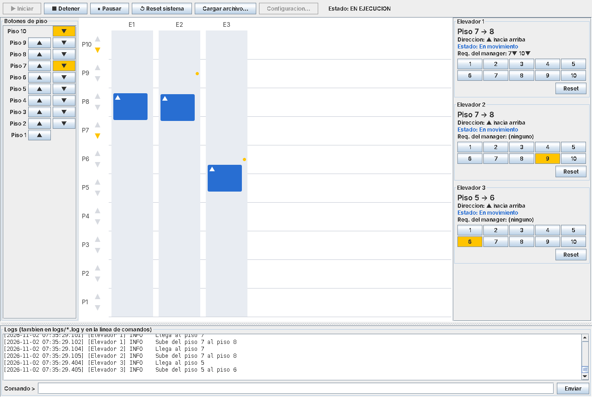

# CC2 – Proyecto #1 – Elevator Manager

Simulador de un sistema de elevadores en Java. Cada elevador y el *Elevator Manager* son
**hilos independientes**. El manager decide qué elevador atiende cada llamada para que la
respuesta sea lo más rápida posible. Todo se maneja desde una **interfaz gráfica (Swing)**.



> 📘 La explicación completa (cómo y por qué está hecho cada cosa) está en
> **[docs/EXPLICACION.md](docs/EXPLICACION.md)**. Léela antes de exponer el proyecto.

---

## Requisitos

- **Java 17 o más reciente** (JDK, no solo JRE). Se usan `record`, `switch` con flechas y
  *pattern matching* de `instanceof`.
- No usa ninguna librería externa.

## Cómo compilar y ejecutar

**Linux / macOS**
```bash
./compilar.sh
./ejecutar.sh                 # abre la ventana de configuración
./ejecutar.sh 3 10 1000 2000  # (opcional) pre-llena: elevadores pisos msEntrePisos msParada
```

**Windows**
```bat
compilar.bat
ejecutar.bat
```

**A mano (cualquier sistema)**
```bash
javac -encoding UTF-8 -d out $(find src -name "*.java")
java -cp out manager.ElevatorManager
```

En un IDE (NetBeans, IntelliJ, Eclipse, VS Code): marca `src` como carpeta de fuentes y
ejecuta la clase **`manager.ElevatorManager`**.

Al iniciar aparece una ventana que pide **cantidad de elevadores**, **cantidad de pisos**,
**tiempo entre pisos (ms)** y **tiempo de espera en una parada (ms)**. Luego presiona
**▶ Iniciar**.

## Uso rápido

| Quiero…                                    | En la GUI                                   | Comando de texto        |
|--------------------------------------------|---------------------------------------------|-------------------------|
| Llamar un elevador desde un piso           | Botones ▲ / ▼ del panel *Botones de piso*   | `CALL 5 DOWN`           |
| Presionar un botón dentro del elevador     | Botones numerados en la tarjeta del elevador| `GOTO 2 8`              |
| Reset de todo el sistema                   | **↺ Reset sistema**                         | `RESET`                 |
| Reset de un elevador                       | Botón **Reset** de su tarjeta               | `RESET 1`               |
| Pausar / reanudar (punto extra)            | **⏸ Pausar** / **▶ Reanudar**              | `PAUSE` / `RESUME`      |
| Ver estado                                 | (siempre visible)                           | `STATUS`                |
| Cargar lista de requerimientos             | **Cargar archivo…** (solo en estado reset)  | —                       |
| Iniciar / detener la simulación            | **▶ Iniciar** / **■ Detener**               | —                       |

Ejemplo de archivo: [`ejemplos/requerimientos-demo.txt`](ejemplos/requerimientos-demo.txt).

Los logs se ven en la ventana, en la terminal y en `logs/elevador1.log`, `logs/elevador2.log`,
…, `logs/manager.log`.

## Estructura

```
src/
├── core/        SimulationProcess (clase base de los hilos), PauseControl, SimulationConfig
├── model/       Direction, Request
├── elevator/    Elevator (hilo), LookAlgorithm, StopSet, ElevatorSnapshot, ElevatorStatus
├── manager/     ElevatorManager (main + hilo de decisión), CostEstimator
├── protocol/    Protocolo de texto: Command, GotoCommand, PickupCommand, ResetCommand, parsers
├── logging/     LogFactory, SimulationLogFormatter, StdoutHandler, GuiLogHandler
├── io/          RequestFileLoader, RequestFilePlayer (hilo), ScheduledCommand
└── gui/         ControlConsole, BuildingPanel, ElevatorCard, FloorCallPanel, ConfigDialog
```

## Entrega

```bash
./empaquetar.sh 10A     # crea pj1-grupo10A.zip (cambia 10A por tu número de grupo)
```
